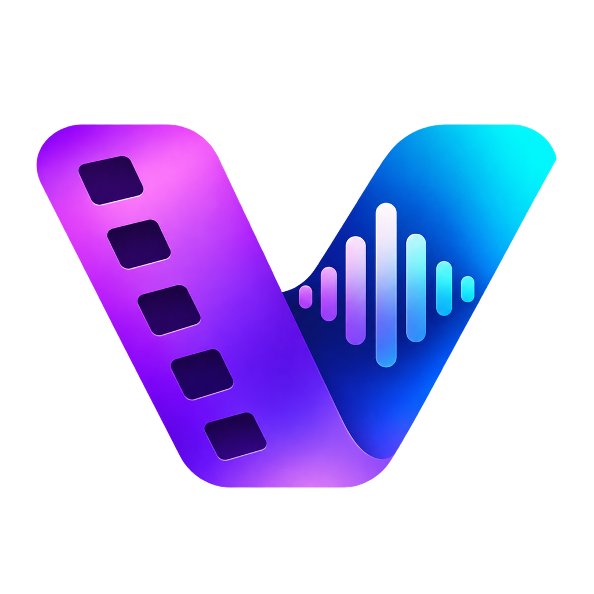

<div align="center">



# Vokhira Studio

### *Give Every Story a Voice.*

[-blue?logo=windows)](https://github.com/ehak-math/vokhira-studio-releases/releases)
[](https://github.com/ehak-math/vokhira-studio-releases/releases)
[](#beta-notice)
[](LICENSE-NOTICES.md)

**The standalone desktop studio for Chinese-to-Khmer AI video dubbing, contextual subtitle translation, and multi-track audio production.**

[Download Latest Release](https://github.com/ehak-math/vokhira-studio-releases/releases) • [Installation Guide](INSTALLATION_GUIDE.md) • [Known Issues](KNOWN_ISSUES.md) • [Changelog](CHANGELOG.md) • [Support](SUPPORT.md)

</div>

---

## 📌 Repository Notice

This repository (`ehak-math/vokhira-studio-releases`) is the **official public distribution, download, and issue tracking hub** for Vokhira Studio.

- The application core and source code are maintained in a private repository (`ehak-math/vokhira-studio`).
- **Official standalone Windows installers, update metadata (`latest.yml`), and SHA-256 checksums are distributed exclusively through [GitHub Releases](https://github.com/ehak-math/vokhira-studio-releases/releases).**
- Community bug reports, feature requests, and feedback are welcomed via [GitHub Issues](https://github.com/ehak-math/vokhira-studio-releases/issues).

---

## 🎬 Product Overview

**Vokhira Studio** is designed for content creators, translators, and video editors dubbing Chinese short dramas, educational videos, and media into natural, expressive Khmer.

Unlike fragmented toolchains that require multiple separate scripts, command-line utilities, and external audio editors, Vokhira Studio packages an entire production pipeline into a single, cohesive Windows desktop application. From raw video import to final H.264/AAC export with burned-in Khmer typography, every step is synchronized in an intuitive multi-track timeline.

---

## ✨ Key Features

### 🎧 Local Speech Recognition (Offline ASR)
- **Faster-Whisper on CPU**: Transcribe Chinese dialogue out of the box using optimized INT8 quantized Whisper models (`whisper-tiny`, `whisper-small`, `whisper-medium`, `whisper-large-v3-turbo`).
- **Silero VAD & Word Timestamps**: Automatic voice activity detection filters out silence, background noise, and music, providing accurate subtitle timing.
- **SRT File Interoperability**: Import pre-existing Chinese `.srt` subtitles or export timed Chinese/Khmer subtitle files at any stage.

### 🌐 Intelligent Dialogue Translation
- **Context-Aware Google Gemini Translation**: Translates conversational dialogue with full scene context, character glossary enforcement, and custom translation style rules.
- **Resilient Batch Checkpointing**: Translates in managed batches with automatic rate-limit backoff and crash-safe progress saving.
- **Offline Translation Option**: Fallback support for local neural machine translation via Meta NLLB (`facebook/nllb-200-distilled-600M`) without requiring an API key.

### 🎙️ Multi-Voice Khmer Audio Synthesis
- **Microsoft Edge Neural Khmer TTS**: High-fidelity online streaming voices (`km-KH-PisethNeural` and `km-KH-SreymomNeural`) with distinct natural intonation.
- **Offline Meta MMS Khmer TTS**: Built-in offline voice synthesis (`facebook/mms-tts-khm`) with pitch presets (`low`, `neutral`, `high`) ensuring full offline productivity.
- **Single-Sentence Audition**: Instantly re-synthesize, tweak, and audition individual dialogue clips without re-rendering the whole timeline.
- **Independent Speed & Boundary Alignment**: Automatic clip duration matching and silence-aware gap adjustment prevent overlapping voices.

### 🎛️ Multi-Track Video Editor & Master Export
- **Synchronized Video Preview**: Frame-accurate transport controls, volume meters, and real-time Khmer audio playback.
- **Dedicated Track Controls**: Independent mute, solo, lock, and volume controls for **Original Audio**, **Khmer Dialogue**, **Music & Effects**, **Subtitles**, and **Visual Overlays**.
- **Production MP4 Export**: High-performance FFmpeg rendering supporting burned-in styled Khmer subtitles, soft subtitle streams (`mov_text`), and duration verification.

---

## 💻 System Requirements

Vokhira Studio bundles its own isolated Python runtime and FFmpeg binaries. You do **not** need to install Node.js, Python, or FFmpeg on your system.

| Component | Minimum Requirements | Recommended Specifications |
|---|---|---|
| **Operating System** | Windows 10 64-bit (Version 1903+) | Windows 11 64-bit (Latest build) |
| **Processor (CPU)** | Intel Core i3 / AMD Ryzen 3 (4 cores) | Intel Core i5/i7 or AMD Ryzen 5/7 (6+ cores, AVX2 support) |
| **Memory (RAM)** | 8 GB RAM (usable for `whisper-tiny` / `small`) | 16 GB+ RAM (recommended for `whisper-medium` & multi-tasking) |
| **Storage (Disk)** | 4 GB free disk space on system drive | 15 GB+ free SSD storage (for AI models and video project cache) |
| **Graphics (GPU)** | Standard DirectX 11 / OpenGL compatible | Discrete GPU (optional; core AI inference runs on optimized CPU) |
| **Network** | Offline supported for core features | Broadband connection for model downloads, Gemini API, and Edge TTS |

---

## 📥 Download & Installation

1. Navigate to the official **[Releases Page](https://github.com/ehak-math/vokhira-studio-releases/releases)**.
2. Under the latest release assets, download:
   - `Vokhira-Studio-Setup-<version>.exe`
   - `Vokhira-Studio-Setup-<version>.exe.sha256`
3. Verify the installer checksum in PowerShell:
   ```powershell
   Get-FileHash .\Vokhira-Studio-Setup-0.4.22.exe -Algorithm SHA256
   ```
4. Double-click the installer and follow the setup wizard.
5. Refer to the complete **[Installation & First-Launch Guide](INSTALLATION_GUIDE.md)** for detailed walkthroughs, SmartScreen notices, and model configuration.

> *Note: If no public release has been published yet, downloads will become available as soon as the first official release build is published.*

---

## 🔄 Software Updates

Vokhira Studio includes an integrated update client:
- The application periodically checks this repository for new releases.
- When an update is detected, an update notification will guide you through downloading and applying the latest version.
- Existing projects, settings, and downloaded AI models are stored in `%APPDATA%\Vokhira Studio` and are safely preserved across updates.

---

## ⚠️ Beta Notice & Known Limitations

Vokhira Studio is currently in **Public Beta**.
- **Unsigned Installer Notice**: Because early beta installers are not signed with an enterprise Authenticode certificate, Windows Defender SmartScreen may display a *"Windows protected your PC"* prompt. You can safely verify the installer using the official SHA-256 hash published with each release.
- **AI Model Downloads**: To keep the initial installer lightweight (~324 MB), heavy model weights (Whisper ASR, Meta MMS Khmer TTS) are downloaded on-demand inside the application settings.
- Please review **[KNOWN_ISSUES.md](KNOWN_ISSUES.md)** for active workarounds and confirmed limitations.

---

## 🛡️ Security & Privacy

- **Data Privacy**: Your local video files, audio tracks, and exported projects are processed locally on your machine.
- **API Key Security**: If you use Google Gemini for translation, your API key is encrypted using the Windows Data Protection API (**DPAPI**) at `%APPDATA%\Vokhira Studio\credentials\gemini-key.bin`. It is never transmitted to any third-party server other than Google's official Gemini API endpoints.
- **Reporting Vulnerabilities**: Please review our [Security Reporting Guidelines](SUPPORT.md#security-vulnerabilities) to report security issues responsibly.

---

## 🤝 Community & Support

We welcome feedback, issue reports, and workflow suggestions from beta testers:

- 🐛 **Found a bug?** Submit a report using our [Bug Report Form](https://github.com/ehak-math/vokhira-studio-releases/issues/new?template=bug_report.yml).
- 💡 **Have an idea?** Suggest enhancements via our [Feature Request Form](https://github.com/ehak-math/vokhira-studio-releases/issues/new?template=feature_request.yml).
- 📖 **Need assistance?** Read our **[Support Guide](SUPPORT.md)**.
- 📜 **Contribution Guidelines**: Review **[CONTRIBUTING.md](CONTRIBUTING.md)** for details on participating in our community.

---

## ⚖️ License & Third-Party Attributions

Vokhira Studio is distributed as a proprietary desktop application. It bundles and interoperates with open-source runtimes and libraries including **FFmpeg (GPL v3)**, **Python (PSF License)**, **Electron (MIT)**, and community AI model weights.

For full legal notices, source code links for copyleft components, and third-party license texts, please read **[LICENSE-NOTICES.md](LICENSE-NOTICES.md)**.

---

<div align="center">
<sub>Copyright &copy; 2026 Vokhira Studio. All rights reserved.</sub>
</div>
